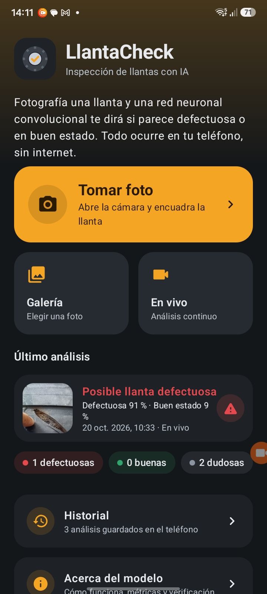
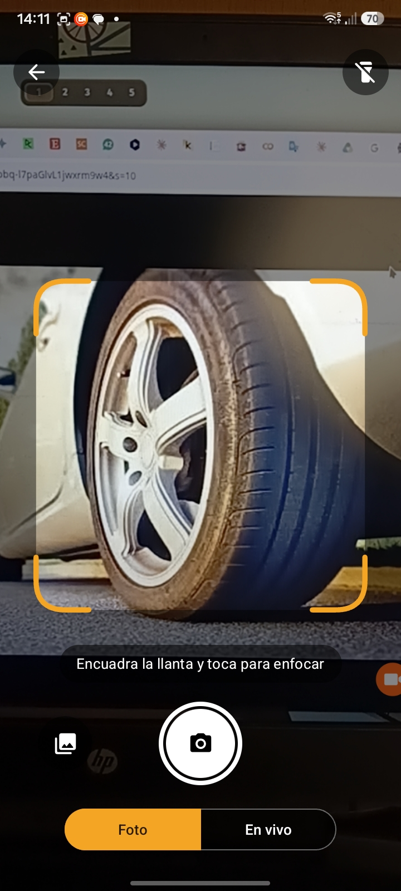
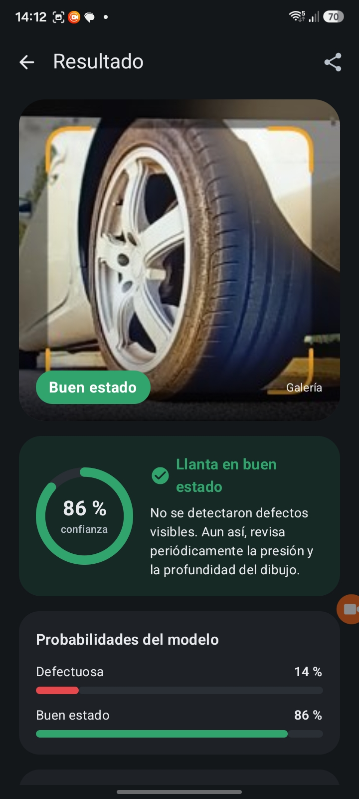
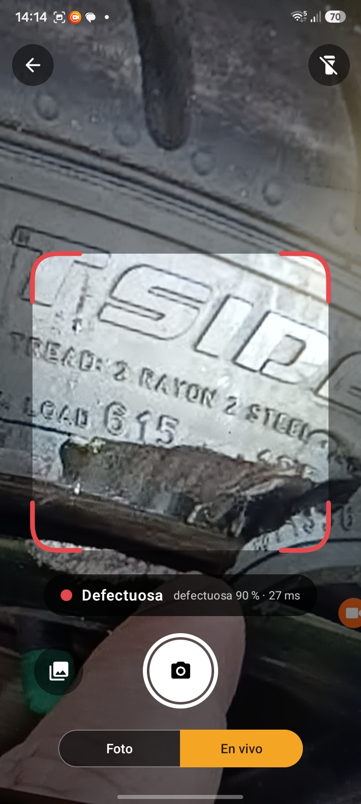
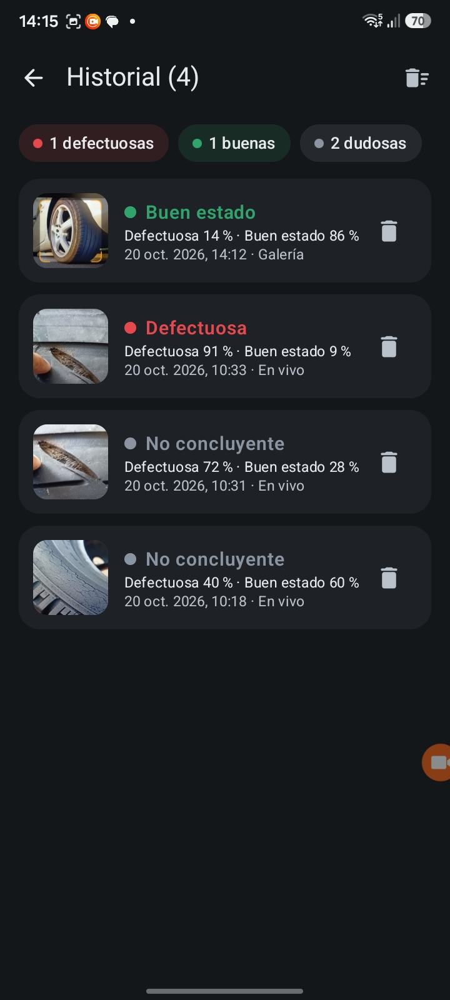
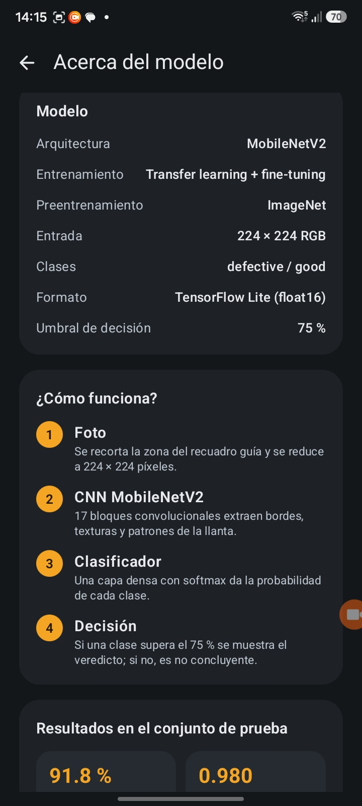
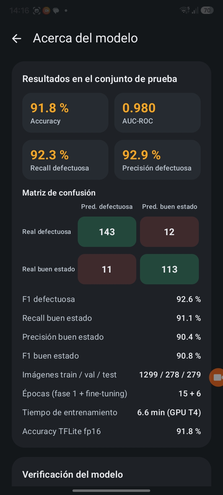
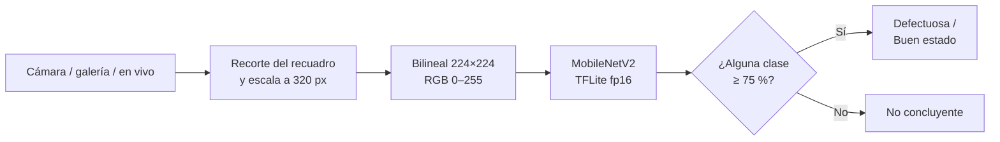

<div align="center">

# LlantaCheck

**Aplicación Android que clasifica la fotografía de una llanta como _defectuosa_ o _en buen estado_ con una Red Neuronal Convolucional (MobileNetV2) que se ejecuta dentro del teléfono, sin conexión a internet.**


### [Descargar APK (14 MB)](https://github.com/YoelCanaza/cnn-llanta-check/raw/main/apk/LlantaCheck-v1.1.apk)

</div>

---

## Capturas

<div align="center">
<table>
  <tr>
    <td align="center"><br><sub>Inicio</sub></td>
    <td align="center"><br><sub>Cámara con recuadro guía</sub></td>
    <td align="center"><br><sub>Resultado</sub></td>
    <td align="center"><br><sub>Modo en vivo (27 ms)</sub></td>
  </tr>
  <tr>
    <td align="center"><br><sub>Historial</sub></td>
    <td align="center"><br><sub>Cómo funciona</sub></td>
    <td align="center"><br><sub>Métricas del modelo</sub></td>
    <td></td>
  </tr>
</table>
</div>

## Características

| Función | Descripción |
|---|---|
| **Cámara** | Recuadro guía, toque para enfocar, zoom con pellizco, linterna, destello y vibración al capturar. |
| **Galería** | Analiza cualquier foto guardada, respetando su orientación EXIF. |
| **En vivo** | Clasificación continua (unas 5 veces por segundo) con resultado suavizado; el recuadro cambia de color según el veredicto. |
| **Resultado** | Anillo de confianza, probabilidad por clase, escala de decisión, aviso de foto oscura o sobreexpuesta y botón para compartir. |
| **Historial** | Análisis anteriores con miniatura y contadores por clase, guardados solo en el teléfono. |
| **Acerca del modelo** | Funcionamiento, métricas de prueba, matriz de confusión y verificación del modelo en el dispositivo. |

La app distingue tres resultados:

| Veredicto | Condición |
|---|---|
| Llanta en buen estado | P(buen estado) ≥ 75 % |
| Posible llanta defectuosa | P(defectuosa) ≥ 75 % |
| No concluyente | Ninguna clase llega al 75 % |

El modelo solo conoce dos clases, así que ante una foto borrosa, mal iluminada o que no es una llanta reparte la probabilidad entre ambas. En esos casos la app prefiere no adivinar.

## Instalación

1. Descarga [`LlantaCheck-v1.1.apk`](apk/LlantaCheck-v1.1.apk) en el teléfono.
2. Ábrelo y permite la instalación desde esa fuente si Android lo solicita.
3. Si aparece Google Play Protect, elige **Instalar de todas formas** (ocurre con toda app que no proviene de Play Store).
4. Concede el permiso de cámara al abrirla por primera vez.

> El modelo se entrenó con **acercamientos a la superficie de la llanta** (banda de rodadura o flanco). Para mejores resultados, acerca la cámara a la zona que quieres revisar y usa buena iluminación.

## Cómo funciona



1. **Foto.** Con la cámara se recorta la zona del recuadro guía; desde la galería se usa la imagen completa.
2. **Escala.** La imagen se reduce a un lado mayor de 320 px, igual que la copia del dataset usada al entrenar.
3. **Redimensionado.** Se lleva a 224 × 224 con interpolación bilineal idéntica a `tf.image.resize` (*half-pixel centers*, sin *antialias*), implementada en Kotlin.
4. **Inferencia.** El tensor `float32 [1, 224, 224, 3]` RGB 0–255 entra al modelo; la normalización a [-1, 1] está dentro del propio modelo.
5. **Decisión.** Se aplica la regla del 75 %.

### Modelo

| | |
|---|---|
| Arquitectura | MobileNetV2 preentrenada en ImageNet + clasificador de 2 clases |
| Entrenamiento | *Transfer learning* en dos fases (Google Colab, GPU T4) |
| Formato | TensorFlow Lite, pesos float16 (4,5 MB) |
| Accuracy en test | **91,8 %** · AUC-ROC 0,980 · recall de defectuosas 92,3 % |
| Latencia | 27 ms por imagen en el teléfono de prueba |

Dataset: Pathmanaban et al. (2023), *Digital images of defective and good condition tyres*, Mendeley Data, [doi:10.17632/bn7ch8tvyp.1](https://doi.org/10.17632/bn7ch8tvyp.1), licencia CC BY 4.0.

## Arquitectura del código

```
app/src/main/
├── java/pe/edu/unap/llantacheck/
│   ├── MainActivity.kt           navegación con pila, transiciones y flujo de análisis
│   ├── ml/
│   │   ├── TyreClassifier.kt     carga del modelo (memory-mapped) e inferencia con LiteRT
│   │   ├── ImagePreprocessor.kt  redimensionado bilineal idéntico a TensorFlow (Kotlin puro)
│   │   ├── BitmapUtils.kt        decodificación, EXIF, recorte al recuadro, escala 320 px
│   │   └── Decision.kt           regla de decisión (umbral 75 %) y aviso de iluminación
│   ├── data/
│   │   ├── HistoryRepository.kt  historial local (JSON + miniaturas JPEG)
│   │   └── ModelInfo.kt          métricas y muestras de verificación
│   └── ui/                       pantallas de Jetpack Compose y componentes
├── assets/
│   ├── tyre_classifier_fp16.tflite   modelo
│   ├── labels.txt                    orden de las clases: defective, good
│   ├── model_info.json               métricas del entrenamiento
│   └── muestras/                     8 imágenes de prueba + probabilidades esperadas
└── res/                              ícono, tema y pantalla de inicio
app/src/test/                         prueba del preprocesamiento contra TensorFlow
apk/                                  APK firmada lista para instalar
docs/capturas/                        capturas de la app
```

| Tecnología | Uso |
|---|---|
| Kotlin 2.1 + Jetpack Compose (Material 3) | Interfaz, tema claro y oscuro |
| CameraX 1.4 | Vista previa, captura y análisis de cuadros |
| LiteRT 1.4 (TensorFlow Lite) | Ejecución del modelo en la CPU |
| ExifInterface | Orientación de las fotos de la galería |
| Gradle 8.14 · AGP 8.11 | Compilación, `minSdk 24`, `targetSdk 35` |

## Compilar

Requisitos: JDK 21 y Android SDK con la plataforma 36.

```bash
echo "sdk.dir=$HOME/Android/Sdk" > local.properties
./gradlew :app:testDebugUnitTest     # prueba del preprocesamiento
./gradlew :app:assembleDebug         # app/build/outputs/apk/debug/app-debug.apk
```

`gradle.properties` fija `org.gradle.java.home` a `/usr/lib/jvm/java-21-openjdk`; ajústalo si tu JDK 21 está en otra ruta.

Para una APK *release* firmada se necesita un `keystore.properties` propio (no se incluye en el repositorio):

```properties
storeFile=keystore/llantacheck.jks
storePassword=...
keyAlias=llantacheck
keyPassword=...
```

Sin ese archivo, `./gradlew :app:assembleRelease` firma con la clave de depuración.

## Verificación

- **Prueba unitaria** (`ImagePreprocessorTest`): compara el redimensionado de la app con `tf.image.resize` de TensorFlow 2.21 sobre imágenes de varios tamaños.
- **En el dispositivo** (*Acerca del modelo → Verificación del modelo*): analiza 8 imágenes del conjunto de prueba y compara la probabilidad obtenida en el teléfono con la calculada en Colab (tolerancia ±2 %). Las muestras se guardan en PNG con los píxeles decodificados por TensorFlow, porque cada decodificador JPEG produce colores ligeramente distintos y eso basta para mover la probabilidad hasta 0,05.

## Actualizar el modelo

El cuaderno de entrenamiento genera `resultados_proyecto.zip`. Para integrarlo:

```bash
PYTHON=/ruta/a/python-con-tensorflow ./integrar_modelo.sh ~/Descargas/resultados_proyecto.zip
```

El script copia el modelo, las etiquetas y las métricas a `assets/`, convierte las muestras a PNG con `muestras_a_png.py`, ejecuta las pruebas y deja la APK en `apk/`.

## Limitaciones

- Distingue solo dos clases: no identifica el tipo de defecto, su gravedad ni su ubicación.
- No mide la profundidad del dibujo ni la presión.
- Se entrenó con un único dataset; con fotos tomadas en otras condiciones el rendimiento puede ser menor.
- Ante imágenes que no son llantas puede responder con confianza alta; el umbral del 75 % reduce el problema, pero no lo elimina.

## Autor

**Canaza Chagua Yoel Nhelio** — Curso Aprendizaje Profundo (Docente: Ing. Huayta Flores Lenin)
Escuela Profesional de Ingeniería de Sistemas, Universidad Nacional del Altiplano – Puno, 2026

---

<sub>LlantaCheck es una herramienta de apoyo con fines académicos y no reemplaza la inspección de un profesional.</sub>
